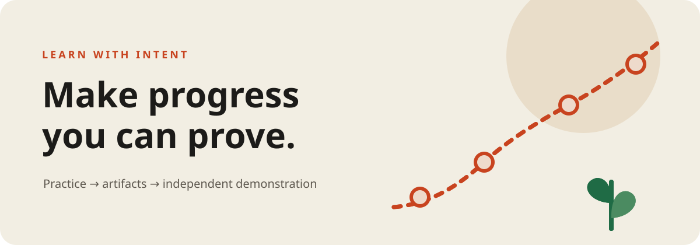
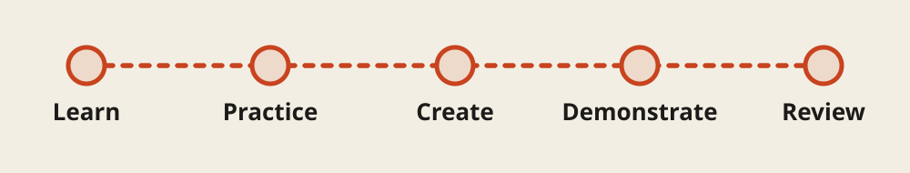
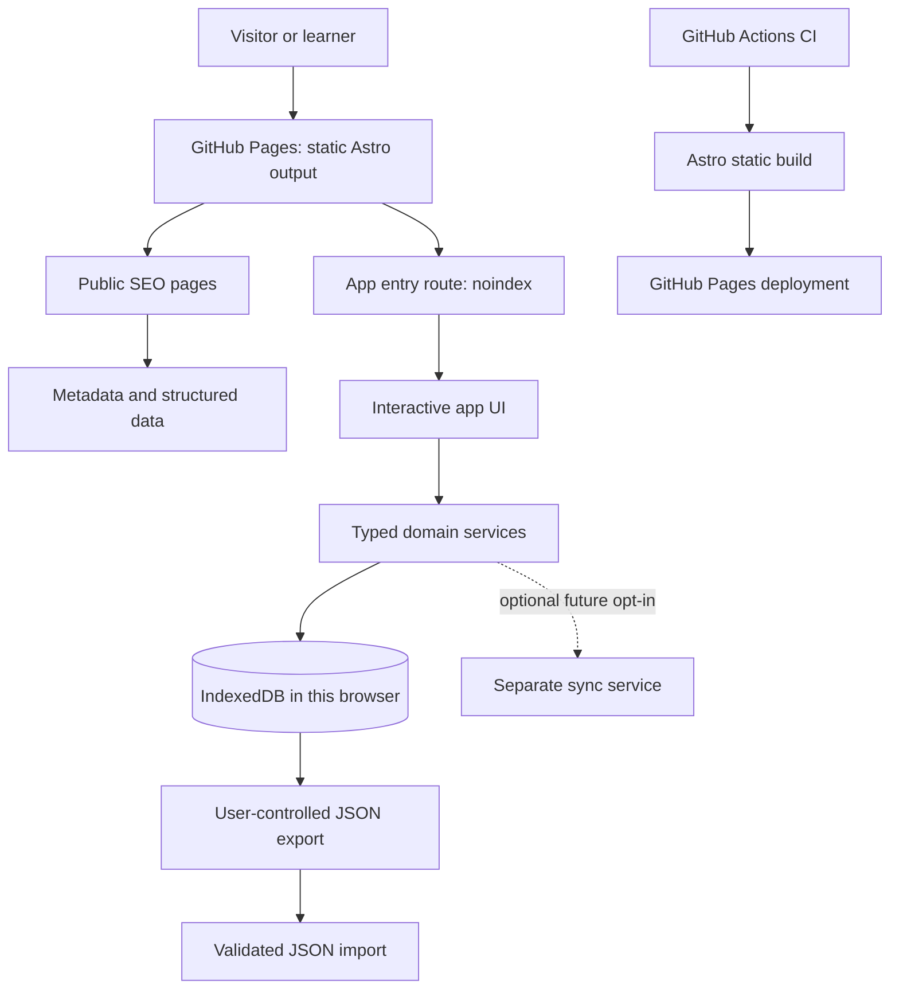
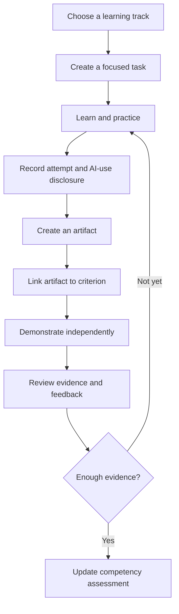
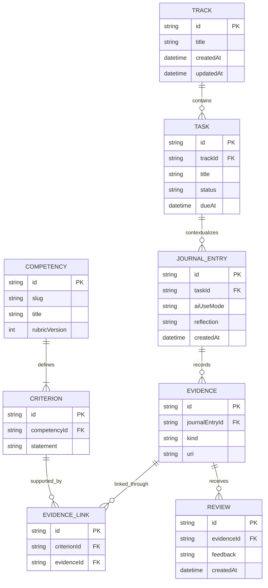
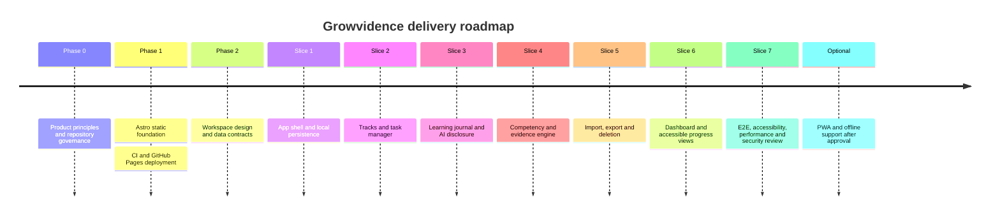

<!-- GitHub renders the Mermaid diagrams below natively. -->

<p align="center">
  <picture>
    <source media="(prefers-color-scheme: dark)" srcset="docs/assets/growvidence-hero-dark.svg">
    <source media="(prefers-color-scheme: light)" srcset="docs/assets/growvidence-hero-light.svg">
    
  </picture>
</p>

<h1 align="center">Growvidence</h1>
<p align="center"><strong>Don't just learn. Prove your progress.</strong></p>
<p align="center">
  <a href="https://github.com/MANayab/Growvidence/actions/workflows/ci.yml"></a>
  <a href="https://github.com/MANayab/Growvidence/actions/workflows/deploy.yml"></a>
</p>

**Growvidence is an evidence-first learning tracker concept for IT beginners, students and self-taught learners.** It aims to turn learning activity into demonstrable capability—not award mastery for ticking boxes, finishing courses or maintaining streaks.

<p align="center"></p>
<p align="center"><em>Learning becomes more meaningful when practice produces evidence that can be independently reviewed.</em></p>

> [!IMPORTANT]
> **Current status (20 November 2026):** The public Astro landing page is live. The interactive learner application has **not** been built yet. The workspace, task manager, journal, competency engine and local data storage are planned—not available features.

**Live site:** [https://manayab.github.io/Growvidence/](https://manayab.github.io/Growvidence/)

---

## What is Growvidence?

Growvidence is designed to connect five parts of a learning journey:

1. **Learn** a concept or skill.
2. **Practice** with deliberate exercises.
3. **Create** a tangible artifact or working result.
4. **Demonstrate** what you can do independently.
5. **Review** the evidence, feedback and remaining gaps.

A completed task records activity. Competency requires observable criteria and evidence that supports an independent demonstration. AI assistance should be disclosed so assisted work is not confused with unaided capability.

## Why evidence over activity?

Course completion, time spent and streaks can show engagement. They do not, by themselves, show that someone can solve a problem without help.

| Activity signal | Evidence signal |
|---|---|
| Watched a tutorial | Built a small implementation from the concept |
| Checked a task | Described the approach and trade-offs |
| Copied a working solution | Reproduced or adapted it independently |
| Used an AI-generated answer | Disclosed assistance and explained what was independently verified |
| Maintained a streak | Repeatedly demonstrated a criterion with reviewable artifacts |

No single artifact automatically proves a broad competency. Criteria, context, independence and review matter.

## Current status

### Available now

- Public, static Astro landing page hosted on GitHub Pages.
- Responsive shared layout, generated 404 page and light/dark system styling.
- Build-time SEO metadata and Organization/WebSite JSON-LD.
- Google Search Console verification meta tag in the shared page head.
- `robots.txt`, homepage sitemap, `llms.txt` and SVG favicon.
- GitHub Actions CI and Astro static deployment workflow.

### Planned — not implemented

- Learner workspace and dashboard.
- Learning tracks, task board and daily/weekly/monthly views.
- Learning journal and explicit AI-use disclosure.
- Competency criteria, evidence records and reviewer feedback.
- IndexedDB local persistence and schema migrations.
- Versioned JSON backup/restore, CSV export and data deletion UX.
- Optional PWA/offline support, subject to scope confirmation.
- Optional account/sync service only after a separate product, privacy and security decision.

There are no user accounts, backend, cloud database, cloud sync, analytics or payment flows in the current MVP.

## Six competency areas

The initial rubric areas below are draft product categories, not certifications or claims of professional qualification. Their measurable criteria will be finalized with maintainer approval in the Phase 2 design work.

<table>
  <tr>
    <td align="center"><br><strong>Independent coding</strong></td>
    <td align="center"><br><strong>Debugging</strong></td>
    <td align="center"><br><strong>Architecture</strong></td>
  </tr>
  <tr>
    <td align="center"><br><strong>Testing</strong></td>
    <td align="center"><br><strong>Commercial validation</strong></td>
    <td align="center"><br><strong>Technical fundamentals</strong></td>
  </tr>
</table>

## System architecture (target)

The public site is static today. The local-first application and optional sync shown below are **future architecture**, not deployed components.



**Architecture boundaries:** GitHub Pages serves generated files; it does not run a backend. Learner records are intended to stay in the browser. Optional future sync is not part of the MVP and requires a separate approval and threat review.

## Learner flow (target)



Task completion and competency status remain separate throughout this flow.

## Core data relationships (proposed)

This ERD is a conceptual model for the future local-first application. It is not a deployed database schema.



The final entities, cardinalities and field constraints are subject to the Phase 2 data-contract design and maintainer approval.

## Roadmap



The detailed, maintained plan is in [docs/ROADMAP.md](docs/ROADMAP.md). Phase 2 begins with design and data contracts; feature slices are separate PRs after that design PR is merged.

## Quick start

### Prerequisites

| Tool | Required version | Check |
|---|---:|---|
| Node.js | `26.7.0` (from `.nvmrc`; package engine is `>=26.7.0`) | `node --version` |
| npm | `>=11.19.0` (from `package.json`) | `npm --version` |
| Git | Installed and available in your terminal | `git --version` |

The repository pins its direct development dependencies in `package.json` and commits `package-lock.json`. Use `npm ci` for a reproducible install. Do not delete or regenerate the lockfile for routine setup.

### Windows PowerShell

Open PowerShell in a writable folder (not `C:\Windows\System32`). The example below uses your Documents folder.

```powershell
Set-Location "$HOME\Documents"
git clone https://github.com/MANayab/Growvidence.git
Set-Location .\Growvidence

node --version
npm --version
git --version

npm ci
npm run dev
```

Open **http://localhost:4321/Growvidence/**. Leave the terminal running while developing; press `Ctrl+C` to stop the server.

### macOS / Linux

```bash
mkdir -p "$HOME/projects"
cd "$HOME/projects"
git clone https://github.com/MANayab/Growvidence.git
cd Growvidence

node --version
npm --version
git --version

npm ci
npm run dev
```

Open **http://localhost:4321/Growvidence/**.

### GitHub Codespaces / Gitpod

Create a Codespace or Gitpod workspace from the repository, open its integrated terminal, confirm the Node.js and npm versions above, then run:

```bash
git clone https://github.com/MANayab/Growvidence.git
cd Growvidence
npm ci
npm run dev
```

Use the forwarded port **4321** and the preview URL provided by the platform. Codespaces/Gitpod provisioning and port forwarding have not been independently tested as part of this documentation change.

## Development scripts

Run these from the repository root.

| Command | Purpose |
|---|---|
| `npm ci` | Install exact dependency versions from the committed lockfile |
| `npm run dev` | Start the local Astro development server |
| `npm run check` | Run Astro and TypeScript diagnostics |
| `npm run lint` | Run ESLint |
| `npm run format` | Format supported source/config files with Prettier |
| `npm run format:check` | Check formatting without changing files |
| `npm test` | Run the Vitest unit tests |
| `npm run build` | Generate the static website in `dist/` |
| `node scripts/verify-build.mjs` | Check required SEO metadata in built HTML |
| `npm run preview` | Preview the generated production build |

### Run all quality checks

```bash
npm run format
npm run check
npm run lint
npm run format:check
npm test
npm run build
node scripts/verify-build.mjs
```

### Preview the production build

```bash
npm run build
npm run preview
```

Open the local URL printed by Astro. The preview command serves the built site; it is not a deployment.

## Project structure

```text
Growvidence/
├── .github/
│   └── workflows/
│       ├── ci.yml              # Pull request and main quality gates
│       └── deploy.yml          # Astro build and GitHub Pages deployment
├── docs/
│   ├── assets/                 # Hand-written README SVG illustrations
│   ├── DECISIONS/              # Architecture decision records
│   ├── ARCHITECTURE.md         # Static/local-first architecture
│   ├── DATA_MODEL.md           # Draft data model
│   ├── QUALITY_GATES.md        # Quality and release requirements
│   └── ROADMAP.md              # Milestones and delivery slices
├── public/                     # Static public assets and crawler files
├── scripts/
│   └── verify-build.mjs        # Built HTML / SEO smoke check
├── src/
│   ├── layouts/                # Shared Astro document layout
│   ├── lib/                    # SEO helpers and tests
│   └── pages/                  # Public pages and generated 404
├── AGENTS.md                   # Contributor and automation rules
├── brain.md                    # Maintained project state / handoff
├── mind.md                     # Product principles and competency areas
├── package.json
├── package-lock.json
└── astro.config.mjs
```

## FAQ

### Can I create an account or sign in?

No. Authentication and cloud accounts are not implemented and are outside the current static MVP.

### Is the learner workspace ready?

Not yet. The public landing page is live; the workspace is a planned Phase 2 build.

### Does checking a task mean I have mastered a skill?

No. Task status records activity. Competency requires measurable criteria and reviewable evidence of demonstrated ability.

### Does Growvidence upload my learning records?

The current public landing page does not collect learner records. The planned MVP is local-first, with browser storage and user-controlled exports. Do not interpret this planned design as an already implemented storage guarantee.

### Is AI use allowed?

The product is intended to distinguish assisted, partially assisted and unassisted work. The journal and disclosure workflow are not implemented yet.

### Is my browser data backed up automatically?

No. IndexedDB is planned, and browser storage is not a backup. A versioned export/import workflow is planned.

### Is Growvidence a certification?

No. It is a learning and evidence-tracking project concept, not an accredited certification or employment guarantee.

### Does Growvidence work offline?

Offline/PWA behavior is not currently offered as a learner feature. It remains a later scope decision.

## Contributing

1. Read [AGENTS.md](AGENTS.md) before changing the repository.
2. Start from the latest `main` and create a focused branch.
3. Keep one purpose per PR; never push directly to `main`.
4. Keep dependency versions pinned and update the lockfile only for intentional dependency changes.
5. Add meaningful tests for behavior changes and update documentation.
6. Report checks only when they have actually run. The maintainer reviews and merges PRs.

## Security

Please do not report security vulnerabilities in public issues. Use GitHub's private vulnerability reporting for this repository if it is enabled; otherwise contact the repository maintainer privately through GitHub.

Security expectations:

- Do not commit secrets, credentials or private learner data.
- Validate imported data and relationships before persistence when import is implemented.
- Keep learner data out of URLs, logs and public assets.
- Reassess the threat model before adding third-party scripts, integrations, accounts or sync.
- Review dependency audit findings; a successful CI run does not mean an informational audit is vulnerability-free.

See [docs/QUALITY_GATES.md](docs/QUALITY_GATES.md) for security, accessibility and release gates.

## Acknowledgements

Growvidence is built with the open web platform and the Astro static-site toolchain. Thanks to the maintainers of Astro, TypeScript, ESLint, Prettier, Vitest and GitHub Actions, and to everyone who shares accessible, privacy-conscious engineering practices.

---

<p align="center"><sub>Growvidence is a working project name. Product scope and architecture decisions remain subject to maintainer review.</sub></p>
