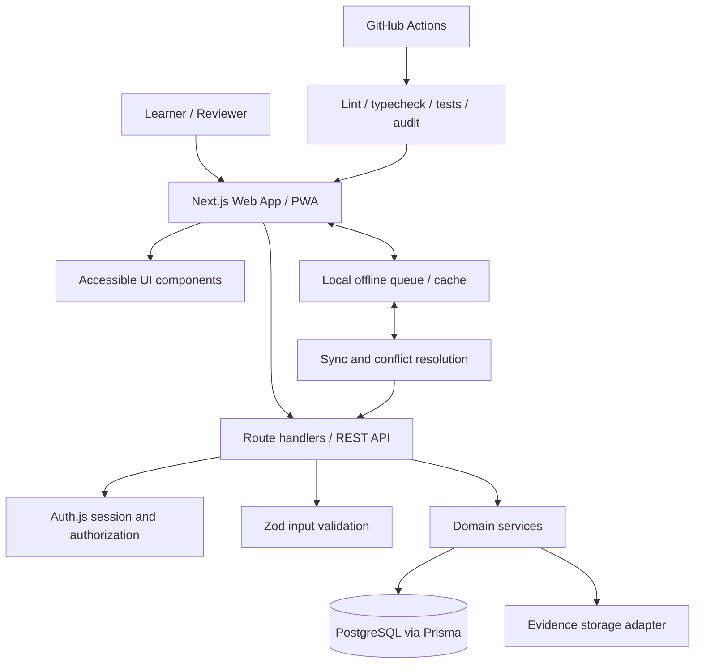

# Architecture proposal

**Status:** Proposed. This document records a direction for review; it does not describe an implemented system.

## Goals

- Deliver a reliable, accessible web-first learning workflow
- Keep task activity, learning records, evidence, and competency assessments distinct
- Support data ownership, export, deletion, and eventual self-hosting
- Provide a responsive PWA before committing to a separate native mobile client
- Keep the system understandable and maintainable for a small team

## Proposed technology choices

| Area | Proposal | Rationale and trade-off |
|---|---|---|
| Web | Next.js App Router | Integrated routing, server rendering, and deployment options; more framework surface than a small static SPA |
| Language | TypeScript strict | Safer refactors and explicit domain contracts; requires disciplined typing |
| UI | Tailwind CSS + shadcn/ui | Composable accessible primitives and consistent styling; components still need accessibility verification |
| Charts | Recharts | React-native chart composition; charts need text/table alternatives and careful bundle/performance review |
| Validation | Zod | Shared runtime validation at trust boundaries; schemas must not replace authorization |
| Database | PostgreSQL | Relational integrity for users, tasks, evidence, and assessments; requires operational backups and migrations |
| ORM | Prisma | Typed data access and migrations; generated abstractions must be reviewed for query behavior |
| Authentication | Auth.js | Established Next.js integration; provider configuration, session strategy, and security remain application responsibilities |
| API | Start with REST route handlers and typed schemas | Simple HTTP contract and easier external integration; tRPC remains an option if internal type sharing proves valuable |
| Live updates | Server-Sent Events when needed | Simpler one-way updates than WebSockets; not suitable for bidirectional real-time collaboration |
| Tests | Vitest + Playwright | Fast unit/integration tests plus browser-level journeys; test coverage is not proof of correctness |
| Delivery | GitHub Actions; Docker for reproducible local/service environments | Repeatable checks and deploys; secrets and deployment permissions must be tightly scoped |

No dependency versions are pinned in this documentation phase. Select supported versions during the tooling phase and commit the lockfile.

## System context

## Logical domain boundaries

- **Identity:** users, sessions, authentication providers, account lifecycle
- **Planning:** tasks, schedules, status, labels, learning tracks
- **Learning journal:** attempts, reflections, time/context notes, AI-use disclosure
- **Evidence:** artifact references, attachments metadata, test results, reviewer comments
- **Competency:** definitions, criteria, assessment events, status history
- **Insights:** derived summaries and reports; never the authoritative source of evidence
- **Sync:** client mutation queue, version checks, conflict handling

Keep domain rules in service modules rather than embedding them only in UI components or database hooks.

## Proposed request flow

1. Browser submits a typed request.
2. Server validates the payload with Zod.
3. Server authenticates the session and checks resource-level authorization.
4. Domain service enforces business invariants.
5. Prisma persists the transaction in PostgreSQL.
6. Response returns only the fields the caller is allowed to see.
7. Audit-relevant state changes are recorded without copying sensitive artifact content into logs.

Validation is not authorization. Every read, update, export, and delete must be scoped to the authenticated owner or explicitly granted collaborator.

## Offline and synchronization strategy

PWA/offline support is planned after the online core is stable.

- Cache only the application shell and explicitly approved static assets by default.
- Store offline drafts locally with a documented retention and encryption decision.
- Do not cache authentication secrets or private evidence in a shared cache.
- Assign each mutation a stable client-generated identifier and base version.
- Use server-side authorization and idempotency checks on sync.
- Detect version conflicts; do not silently overwrite a newer server record.
- Provide a user-visible resolution path and recovery from failed sync.
- Document what is and is not available offline.

IndexedDB may be considered for offline drafts only after a threat model and explicit retention controls. The final policy must distinguish browser-managed app caches from user learning data.

## Evidence storage

Start with URL-based artifact references and metadata where possible. If uploads are introduced, use a storage adapter so self-hosted and managed deployments can choose providers. Enforce file type/size limits, malware scanning where feasible, access control, signed short-lived downloads, and deletion propagation. Never expose private evidence through guessable public URLs.

## Privacy and security principles

- Collect the minimum data required for the learner workflow.
- Provide account export and deletion, including a documented backup-retention window.
- Keep secrets server-side; provide `.env.example` with names and safe descriptions only.
- Apply CSRF protections where relevant, secure cookies, rate limiting, output encoding, and strict authorization.
- Use secure headers and a restrictive Content Security Policy appropriate to the deployment.
- Avoid logging learning reflections, uploaded evidence, tokens, or full request bodies.
- Define retention and consent before adding analytics or third-party integrations.
- Design for GDPR-aligned data rights without claiming legal compliance absent a legal review.
- Support self-hosting only when operational documentation and secure defaults are ready.

## Internationalization and accessibility

- Use locale-aware dates, numbers, and time zones; store timestamps consistently.
- Keep translation strings out of component logic.
- Support keyboard operation, visible focus, semantic headings, labels, reduced motion, and screen-reader status updates.
- Meet WCAG 2.2 AA as a target; verify with automated and manual testing.
- Charts must include a textual or tabular equivalent.

## Mobile direction

Build and validate a responsive web app/PWA first. Evaluate React Native / Expo only when usage research identifies material native capabilities that the PWA cannot provide. Reuse domain contracts and API behavior, not necessarily UI components.

## Deployment model

Initial deployment can use a managed Next.js host and managed PostgreSQL, subject to provider and privacy review. Docker and environment documentation should make local development and a future self-hosted path possible. Do not commit production secrets. Keep staging and production credentials separate.

## Major trade-offs and open decisions

- REST vs tRPC: begin with REST; revisit only if internal developer friction is demonstrated.
- SSE vs WebSockets: defer live updates until a concrete user workflow needs them.
- Uploads vs external links: prefer links initially to reduce storage and privacy burden.
- PWA vs native: PWA first to avoid maintaining two clients prematurely.
- Managed hosting vs self-hosting: document portability, but do not promise one-click self-hosting until tested.
