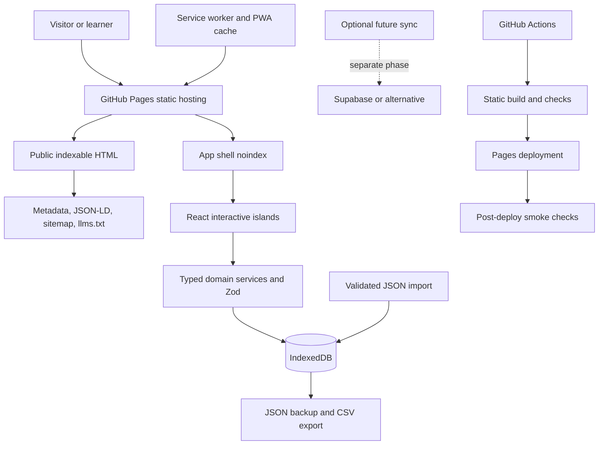

# Architecture proposal — static, local-first

**Status:** The public-site foundation and GitHub Pages publishing pipeline are merged, and the public landing page is live at https://manayab.github.io/Growvidence/. Slice 1 is also merged: the static noindex learner app shell, React island and initial IndexedDB persistence foundation exist. Track/task workflows, journal, competency assessment, evidence management and import/export are not yet implemented. This document remains the architecture proposal for those future learner-application slices.

## Constraints

- Production MVP on GitHub Pages, static files only.
- No server, database, runtime SSR, dynamic API routes, accounts or cloud sync in MVP.
- IndexedDB local data with JSON export/import and CSV export.
- Public pages indexable; app/workspace pages noindex.
- Project URL base path: /Growvidence/. Custom domain later if approved.

## Proposed stack

| Layer | Choice | Trade-off |
|---|---|---|
| Static site | Astro static output (implemented for Phase 1 foundation) | HTML-first public pages and selective hydration; adds Astro concepts. |
| Interactive UI | React islands, strict TypeScript (proposed; not implemented) | React only where needed; client boundaries require discipline. |
| Styling | Tailwind; shadcn/ui-compatible Radix components selectively (proposed; not implemented) | Accessible primitives still require testing and maintenance. |
| Charts | Recharts only when justified (proposed; not implemented) | Bundle cost; provide text/table alternatives. |
| Validation | Zod (proposed; not implemented) | Validate imports and domain boundaries; not a substitute for authorization. |
| Persistence | IndexedDB via repository abstraction (proposed; not implemented) | Async structured browser storage, not backup or cross-device sync. |
| Export | Versioned JSON backup/restore and selected CSV (planned; not implemented) | User portability; CSV is not a lossless backup. |
| Tests | Vitest (configured for foundation) + Playwright (planned; not implemented) | Domain tests and real browser journeys. |
| Hosting | GitHub Pages static output (Astro Actions deployment configured and previously published) | Static only; no runtime backend. |
| Future sync | Optional Supabase or alternative, separate phase | Adds identity, privacy, security, cost and conflict responsibilities. |

## System context

## Routing and base path

- Centralize the base path as /Growvidence/ for the GitHub project site.
- Generate physical HTML for public routes so each page works when opened directly.
- Include a 404 page linking to the project base path.
- Do not rely on server rewrites, middleware, API routes or history fallback. Use generated app entry points or hash routing and test direct refresh on the live Pages URL.
- Canonical URLs include the base path until a custom domain is approved.
- Custom-domain migration requires DNS/Pages configuration and updating canonical URLs, sitemap, links and Search Console.

## Local data lifecycle

1. Browser loads public static assets; no login required.
2. Domain services validate user actions and persist records in IndexedDB.
3. Records have stable IDs, schema versions and created/updated timestamps.
4. JSON export contains all supported stores; import validates format, shape and references, previews changes and requires confirmation.
5. CSV is convenience export, not complete backup.
6. User can explicitly export or clear local data.
7. Cache only the app shell and public assets by default; do not cache private evidence in Cache Storage.

## Indexing

Public marketing, product, guide and documentation pages have unique build-time metadata and remain crawlable. App/workspace pages have a robots noindex directive in generated HTML. Do not disallow those pages in robots.txt if crawlers need to read their noindex. Never rely on JavaScript-only metadata changes.

## SEO/AEO/GEO

See SEO_AEO_GEO.md. Structured data must match visible content; it does not guarantee rich results. No ranking position is guaranteed.

## Optional future backend — not MVP

A separate ADR must assess Supabase or alternatives for account linking, authentication, authorization, encryption, retention, backups, data residency, cost, incident response, applicable license implications and conflict resolution. Local-only operation and export remain available.

## Security and accessibility

Validate imported files, sizes, encodings and relationships. Render learner-authored content safely. Never embed secrets in client assets. No analytics/third-party scripts by default. Target WCAG 2.2 AA with keyboard, focus, labels, semantic structure and reduced motion.

## Slice 4 integrity follow-up (2026-11-27)

- Competency computation now excludes evidence dated after the supplied/current date from qualifying evidence, including repeat checks.
- Repeat evidence must be chronologically later by at least 14 days and show a distinct task or context; same-day and reversed chronology cannot count.
- Locally entered reviewer type/label is not authenticated. Reviews (including records labeled external) no longer independently elevate computed competency to Consistent.
- These are focused integrity corrections on the draft Slice 4 branch. Repository relationship validation, deleted-record restore UI, complete accessibility and repository integration coverage remain outstanding and must not be assumed implemented. Verification is pending maintainer-local checks.

### Superseding status — 2026-11-27
Repository checks have since been added for competency criterion keys, active linked journal/task records, and review links to active evidence. Restore also revalidates evidence links. Deleted evidence/review recovery controls have been added. These remain unverified until local checks and exact-head CI pass.

### Linked-record lifecycle guard — 2026-11-27
Competency calculation must validate optional journal/task references at read-time as well as save/restore time. Evidence with a missing or soft-deleted linked record is excluded from both qualification and partial-progress counts. Regression coverage is added but not yet executed locally.
