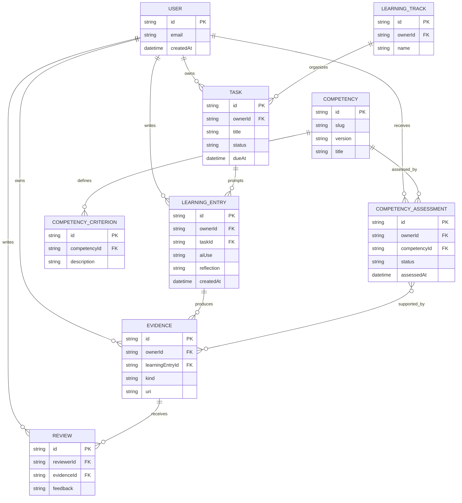

# Data model proposal

**Status:** Draft domain model for discussion. Not implemented and not a migration contract.

## Modeling principles

- A task represents planned activity; completing it is not proof of competency.
- A learning entry records an attempt and its context, including AI assistance.
- Evidence is a separately addressable artifact or reference.
- Competency definitions and criteria are versioned so historical assessments remain interpretable.
- Assessment events preserve who assessed, which criteria were applied, and what evidence supported the result.
- All user-owned records must have explicit ownership and authorization rules.

## Entity relationship diagram



## Proposed Prisma schema draft

This is a conceptual starting point. Validate relation syntax, indexes, deletion behavior, and authorization before adopting it in a migration.

```prisma
enum TaskStatus {
  BACKLOG
  TODO
  IN_PROGRESS
  BLOCKED
  DONE
  ARCHIVED
}

enum AiUse {
  NONE
  ASSISTED
  GENERATED_OR_SUBSTANTIAL
  UNKNOWN
}

enum EvidenceKind {
  REPOSITORY
  URL
  DOCUMENT
  IMAGE
  TEST_RESULT
  REVIEW_NOTE
  OTHER
}

enum CompetencyStatus {
  NOT_ASSESSED
  IN_PROGRESS
  NEEDS_MORE_EVIDENCE
  DEMONSTRATED
}

model User {
  id          String         @id @default(cuid())
  email       String         @unique
  createdAt   DateTime       @default(now())
  tasks       Task[]
  entries     LearningEntry[]
  evidence    Evidence[]
  assessments CompetencyAssessment[]
  tracks      LearningTrack[]
}

model LearningTrack {
  id        String   @id @default(cuid())
  ownerId   String
  name      String
  createdAt DateTime @default(now())
  owner     User     @relation(fields: [ownerId], references: [id], onDelete: Cascade)
  tasks     Task[]
  @@index([ownerId])
}

model Task {
  id          String       @id @default(cuid())
  ownerId     String
  trackId     String?
  title       String
  description String?
  status      TaskStatus   @default(TODO)
  dueAt       DateTime?
  createdAt   DateTime     @default(now())
  updatedAt   DateTime     @updatedAt
  owner       User         @relation(fields: [ownerId], references: [id], onDelete: Cascade)
  track       LearningTrack? @relation(fields: [trackId], references: [id], onDelete: SetNull)
  entries     LearningEntry[]
  @@index([ownerId, status])
  @@index([ownerId, dueAt])
}

model LearningEntry {
  id          String    @id @default(cuid())
  ownerId     String
  taskId      String?
  summary     String
  reflection  String?
  aiUse       AiUse     @default(UNKNOWN)
  independentWorkDescription String?
  createdAt   DateTime  @default(now())
  owner       User      @relation(fields: [ownerId], references: [id], onDelete: Cascade)
  task        Task?     @relation(fields: [taskId], references: [id], onDelete: SetNull)
  evidence    Evidence[]
  @@index([ownerId, createdAt])
}

model Evidence {
  id              String   @id @default(cuid())
  ownerId         String
  learningEntryId String?
  kind            EvidenceKind
  title           String
  uri             String?
  description     String?
  createdAt       DateTime @default(now())
  owner           User     @relation(fields: [ownerId], references: [id], onDelete: Cascade)
  learningEntry   LearningEntry? @relation(fields: [learningEntryId], references: [id], onDelete: SetNull)
  @@index([ownerId, createdAt])
}

model Competency {
  id          String   @id @default(cuid())
  slug        String   @unique
  version     Int
  title       String
  description String
  criteria    CompetencyCriterion[]
  assessments CompetencyAssessment[]
}

model CompetencyCriterion {
  id           String @id @default(cuid())
  competencyId String
  key          String
  description  String
  competency   Competency @relation(fields: [competencyId], references: [id], onDelete: Cascade)
  @@unique([competencyId, key])
}

model CompetencyAssessment {
  id           String   @id @default(cuid())
  ownerId      String
  competencyId String
  status       CompetencyStatus @default(NOT_ASSESSED)
  rationale    String
  assessedAt   DateTime @default(now())
  owner        User       @relation(fields: [ownerId], references: [id], onDelete: Cascade)
  competency   Competency @relation(fields: [competencyId], references: [id], onDelete: Restrict)
  @@index([ownerId, competencyId, assessedAt])
}
```

## Proposed initial competency framework

These are initial learning rubrics, not externally accredited standards:

1. **Independent coding:** build a small feature without AI-generated code and explain the implementation.
2. **Debugging:** diagnose and fix three unfamiliar defects, documenting the reasoning.
3. **Architecture:** explain a design and defend relevant trade-offs.
4. **Testing:** independently write and run tests for expected and edge behavior.
5. **Commercial validation:** collect real customer feedback and test willingness to pay; keep this separate from coding mastery.
6. **Technical fundamentals:** explain and safely modify an existing codebase.

Each competency needs observable criteria, acceptable evidence examples, assessor guidance, and a clear “insufficient evidence” state before implementation.

## Open modeling questions

- Whether reviewers are users with explicit grants or external invited identities
- Attachment storage provider and retention/deletion semantics
- Whether tasks can be shared across tracks
- Assessment rubric versioning and immutable history
- Whether a user can maintain multiple learning profiles
- Time-zone and recurrence representation for daily/weekly/monthly tasks
- Consent and retention requirements for any future analytics

Do not implement this draft directly without resolving these questions and reviewing authorization and cascade behavior.
