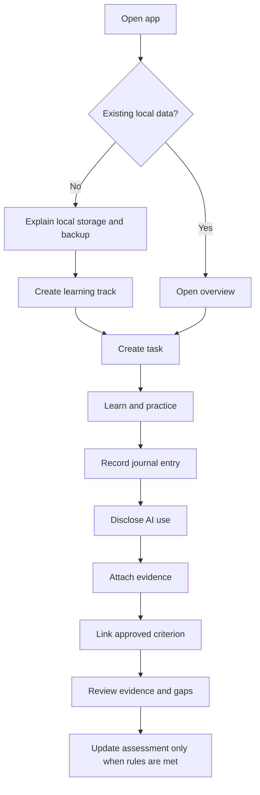
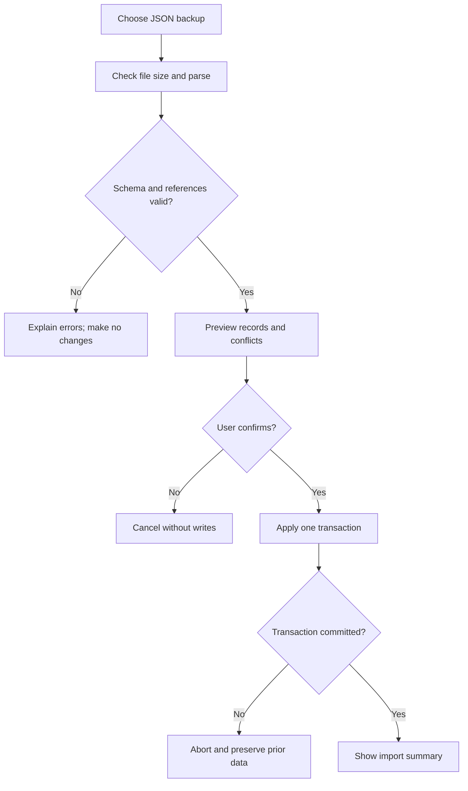

# Learner workspace UX specification

- **Status:** Proposed design; no workspace UI is implemented.
- **Audience:** IT beginners, students, self-taught learners and reviewers.
- **Product promise:** “Don't just learn. Prove your progress.”
- **Core rule:** task completion records activity; competency status requires criteria and evidence.

## Information architecture

The future app lives under `/Growvidence/app/` and follows ADR-0005: static app entry route, React workspace island, hash-based internal navigation, build-time noindex, and exclusion from the sitemap.

Primary navigation:

1. **Overview** — next actions, recent learning, backup status and evidence/competency snapshot.
2. **Tracks** — learning goals and track-level organization.
3. **Tasks** — list and Kanban views with filters and due dates.
4. **Journal** — learning attempts, reflection and AI-use disclosure.
5. **Competencies** — six competency areas, criteria, evidence and assessment state.
6. **Data & settings** — export, import, local deletion, backup reminders and accessibility preferences.

Avoid gamified scores that imply mastery. Streaks, if later included, are optional activity context and never a competency signal.

## Screen specifications

### Overview dashboard

- Show a clear “Continue learning” action and a short list of in-progress/blocked tasks.
- Show recently edited journal entries and evidence needing review.
- Show competency states as “Not assessed”, “Emerging”, “Developing”, “Demonstrated” or “Needs more evidence”; do not derive them from task counts.
- Explain why a competency has its current state and link to its approved criteria/evidence.
- Display last successful JSON export date and backup reminder state.
- Provide text summaries and tables for any chart; do not rely on color or chart position alone.
- Empty state: explain how to create a track and first task; offer a sample workflow without silently inserting fake learner evidence.

### Daily, weekly and monthly views

- Daily view: tasks due today, planned focus, recently recorded attempts and a simple “what did I learn?” prompt.
- Weekly view: tasks planned/in progress/blocked/done, journal activity and review follow-ups.
- Monthly view: completed learning activities and evidence created, plus reflection prompts.
- Date ranges use the learner's local calendar for display and ISO UTC timestamps for storage.
- Empty states distinguish “no tasks planned” from “no learning evidence recorded”.
- Do not imply that more activity means higher competency.

### Tracks

- A track has a title, optional description, optional color and archive action.
- Show task counts by status as navigation aids only.
- Empty state: “Create a learning track” with a short example and explanation.
- Archiving a track does not delete its tasks, journal entries or evidence.
- Prevent deletion of a track with dependent tasks unless the user chooses a clearly explained cascade/reassignment action.

### Tasks: list and Kanban

- Support list and Kanban representations of the same task records.
- Statuses: Backlog, Planned, In progress, Blocked, Done and Cancelled.
- Each task can have title, description, priority, optional due date and optional estimate.
- Keyboard users can move between cards and change status using labeled controls; drag-and-drop is never the only interaction.
- Provide filters by track, status, priority and due date, plus a useful no-results state.
- Completing a task records task status only. UI must not display “skill mastered” as a result.

### Journal

- Create an entry independently or from a task.
- Fields: title, summary, reflection, optional attempted-at date, optional task link and required AI-use disclosure.
- AI-use modes: unassisted, assisted, partially assisted, unknown and not recorded.
- When assisted or partially assisted, ask which tool(s) were used, what AI generated and what the learner personally contributed. These fields may be concise but must not be fabricated.
- If unknown/not recorded, show a neutral “disclosure incomplete/uncertain” state rather than treating it as unassisted.
- Empty state: prompt the learner to record one attempt, obstacle, decision and next step.

### Competencies and evidence

- List the six competencies and show rubric version, assessment state and criteria approval status.
- Criteria not yet approved must be visibly labeled **NEEDS APPROVAL** and must not drive a final “Demonstrated” assessment.
- Evidence form: title, kind, description, optional external artifact URL, optional journal link, AI-use disclosure and independent-demonstration statement.
- Evidence links connect an artifact to one or more criteria with a rationale.
- Reviews record reviewer label/relationship, feedback, outcome and date. Do not require reviewer accounts.
- Assessment view shows each criterion, linked evidence, missing evidence and review context.
- “Demonstrated” is available only when criteria are approved and the evidence rules are met; a learner self-assessment alone cannot silently certify competence. The exact threshold is **NEEDS APPROVAL**.

### Data and settings

- Show storage status, last successful backup date and a reminder; clearly state browser storage is not cloud backup.
- JSON export is the full backup. CSV is a convenience report only.
- Import flow: choose file → validate → preview → resolve conflicts → confirm → transaction → result.
- “Delete all local data” is separated from ordinary settings, requires explicit confirmation, offers export first and reports the result.
- Explain that browser cleanup/device loss may permanently remove local records.

## Interaction and accessibility requirements

Target WCAG 2.2 AA. Automated checks are necessary but do not replace manual review.

- Semantic landmarks, headings in order, native buttons/links/forms and explicit labels.
- All controls reachable and operable by keyboard; visible focus never hidden by sticky headers or overlays.
- Focus moves predictably when dialogs open/close, routes change, validation fails or records are deleted.
- Announce async save/import/export outcomes and validation errors with appropriate live regions; do not announce every keystroke.
- Errors are identified in text, associated with fields and include recovery instructions.
- Contrast meets WCAG AA; never encode status by color alone.
- Respect `prefers-reduced-motion`; avoid essential motion and disable nonessential transitions.
- Touch targets should be comfortably usable on small screens; avoid hover-only actions.
- Dialogs trap focus appropriately, support Escape when safe, and return focus to the trigger.
- Kanban has a complete non-drag keyboard path and an equivalent list view.
- Charts require a plain-language summary and data table alternative.
- Support browser zoom to 200% and reflow at narrow widths without two-dimensional scrolling for ordinary content.

## Responsive behavior

- Small screens: single-column layout, compact top header, navigation drawer or bottom navigation with accessible labels, stacked cards and full-width forms.
- Medium screens: collapsible side navigation and two-column dashboard where content permits.
- Wide screens: persistent side navigation, constrained reading width and optional multi-column dashboard.
- Task Kanban may horizontally scroll only within its labeled board region; provide list view as an alternative.
- Avoid fixed heights for journal text and evidence descriptions.

## Empty, loading and error states

Every screen must distinguish:
- First use / no records yet.
- No matching results after filtering.
- Saved successfully.
- Save pending or failed.
- Storage unavailable/quota exceeded.
- Import invalid or unsupported.
- Import conflicts awaiting choice.
- No backup yet / backup overdue.
- No evidence linked / evidence insufficient.
- Criteria awaiting approval.

Never show a success state before the IndexedDB transaction or file operation actually completes. If a save fails, preserve current in-memory form data and explain that it is not safely stored yet.

## Key flows

### First-use and learning flow

### Import flow

## Content and tone

Use plain, supportive language. Prefer “You have evidence for…” over “You are an expert”. Avoid shame-based streak messaging, unsupported career-readiness scores, certifications, employment guarantees or claims of AI detection. Explain uncertainty in everyday terms.

## UX acceptance checklist

- Every primary workflow is possible by keyboard.
- Every form has labels, inline errors and a recovery path.
- Empty, loading, success, conflict and failure states are designed.
- Task completion and competency status are visually and semantically distinct.
- AI-use disclosure never defaults to unassisted.
- Evidence links show the criterion and rationale.
- Noindex and data-backup messaging are present in the app shell.
- Narrow mobile, 200% zoom and reduced-motion behavior are included in QA.

## Approved decision requirements

## Decisions log — 2026-11-21

| # | Decision | Outcome |
|---|---|---|
| 1 | Workspace UI | Accepted: Astro static site with React islands; Preact only if measured bundle constraints justify it. |
| 2 | IndexedDB | Accepted: idb behind a typed repository adapter. |
| 3 | Competency levels | NEEDS APPROVAL: Demonstrated and Consistent definitions remain proposed. |
| 4 | Import limit | Accepted: 10 MiB; reject larger files before parsing/writing. |
| 5 | Import modes | Accepted: preview, then “Replace everything” or “Merge (newer updatedAt wins)”; atomic application. Per-record choices deferred. |
| 6 | Backup reminders | Accepted: dismissible reminder 30 days after last successful export, plus first-export prompt after meaningful data accumulates. |
| 7 | Evidence URLs | Accepted: HTTP/HTTPS only; reject other schemes; external links use rel="noopener noreferrer"; never fetch, preview or embed. |
| 8 | Reviews | Accepted: reviewerType is self or external; clearly distinguish in UI. Proposed Consistent corroboration weight: external 2, self 1. |
| 9 | CSV | Accepted: task-centric convenience export; neutralize cells beginning with =, +, - or @; unit tests required. JSON is full backup. |
| 10 | PWA | Accepted: defer until after Slice 7; separate explicit approval required. |
| 11 | Bundle/charts | Accepted: 200 KiB gzip initial workspace JS excluding Astro-shared assets; hand-built SVG or lazy-loaded charts; bundle-size check required. |
| 12 | Deletion | Accepted: soft-deleted records remain in JSON backups; per-record Permanently delete and Delete all local data; no timed purge. |

### Competency levels — NEEDS APPROVAL

- **Demonstrated (NEEDS APPROVAL):** every mandatory criterion has at least one independent artifact.
- **Consistent (NEEDS APPROVAL):** the demonstration is repeated in a different task or context.
- Proposed Consistent corroboration: external review weight 2, self review weight 1. Reviews cannot replace the required independent artifact or repeated demonstration.

### UX requirements

- Show Demonstrated and Consistent separately; both definitions remain NEEDS APPROVAL.
- Visually and accessibly distinguish self and external reviews without relying on color alone. Explain proposed weights (external 2, self 1); reviews never replace artifacts or repeated demonstrations.
- Import preview offers exactly “Replace everything” and “Merge (newer updatedAt wins)”. Merge adds new IDs and replaces matching records only when imported updatedAt is newer. Per-record choices are deferred. Reject files above 10 MiB. Apply atomically.
- Evidence URLs accept HTTP/HTTPS only. Reject javascript:, data: and other schemes. External links use rel="noopener noreferrer"; never fetch, preview or embed.
- Provide soft delete, per-record “Permanently delete” and “Delete all local data”. State clearly: **Soft-deleted items remain in JSON backups until permanently deleted.**
- Initial workspace JS budget is 200 KiB gzip excluding Astro-shared assets. Charts are hand-built lightweight SVG or lazy-loaded; provide text/table alternatives and a bundle-size check.
